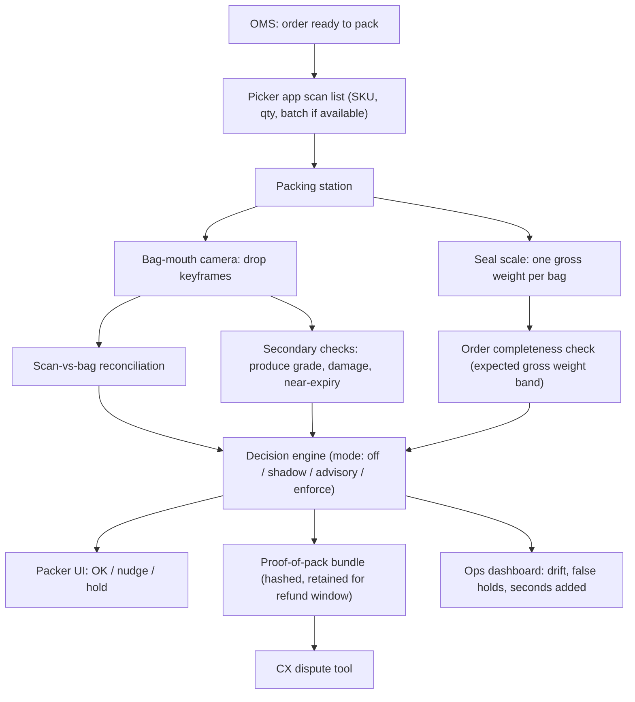

# Product direction: fixing the project idea (I1–I9)

This document reworks the Insta-Audit concept so it targets gaps that quick-commerce operations (Instamart and similar dark-store networks) actually have, fits within a 10-minute delivery SLA, and can be justified economically. It addresses the nine idea-level loopholes identified in the project review (I1–I9).

> **Status:** this is a design document. Section 12 lists what is implemented in this repository today versus what is planned. Nothing here is a measured Instamart result; all operational numbers must come from a shadow-mode pilot. Assumptions about store workflows (e.g. picker barcode scanning, ASN contents) must be confirmed with store operations before build-out.

---

## 1. Revised positioning

**Before:** "Visual SKU verification of every item dropped into the bag."

**After:** **"Proof-of-pack and order-completeness assurance for dark stores."**
Insta-Audit records tamper-evident evidence of what went into each bag, checks order completeness with a single sealed-bag weighing, covers the items a barcode scan cannot (produce, quantity, damage, near-expiry), and stays advisory unless it is highly confident. Visual SKU identity is a *secondary* signal that audits the existing scan; it does not replace it.

### Design principles

1. **Barcode-first.** Where the picker app already scans an item, trust the scan for identity. Vision audits the scan (scanned-but-not-bagged, bagged-but-not-scanned) instead of repeating it.
2. **Order-level before item-level.** One weighing at seal time is cheaper and more robust than per-item weight deltas.
3. **Evidence over blocking.** The default output is an evidence bundle plus advisory flags. Hard holds are reserved for high-confidence, high-cost errors.
4. **No new per-item packer friction.** The packer should not wait on the system for a correct order.
5. **Graceful degradation.** If a model, camera, or SKU enrollment is missing, the system falls back to the scan and weight checks; it never invents confidence.
6. **Privacy by design.** Bag-mouth-only capture, on-edge processing, label and face redaction, short retention.

---

## 2. Revised end-to-end flow

At inwarding (GRN), a separate flow enrolls new SKUs and verifies expiry and produce grade (sections 7–9).

---

## 3. I1: Avoid duplicating the barcode scan

**Gap.** For packaged goods, a barcode scan during picking already establishes SKU identity. Re-verifying identity visually adds cost while catching few new errors.

**Revised design: audit the scan, cover what it misses.**

| Error class | Does a barcode scan catch it? | Insta-Audit check |
|---|---|---|
| Wrong packaged SKU picked | Yes (if scanned) | Trust the scan. Vision only flags a strong disagreement. |
| Item scanned but not bagged (left in tote/shelf) | No | Scan list vs. bag drop events + seal weight shortfall |
| Item bagged twice / extra item | No | Drop count + seal weight excess |
| Wrong quantity (scanned once, qty 3 required) | Partially | Seal weight band; drop count |
| Produce / loose items without barcode | No | Weight band + produce grade check |
| Damaged / leaking pack | No | Damage flag from drop keyframes (planned) |
| Near-expiry item picked | No, unless batch is scanned | Pick-time expiry check (section 9) |
| Item moved to the wrong order's bag | No | Drop events keyed to `order_id` + `bag_id` |

**System changes.**
- Ingest the picker scan list per order (`sku`, `qty`, `scan_ts`, optional `batch`) from the OMS/picker app.
- Reconciliation compares *scanned* vs. *bagged* (drop events) vs. *weighed* (seal weight). The existing `/v1/packing/reconcile` endpoint is the starting point and moves from client-supplied counts to OMS and sensor-derived counts.
- Visual SKU match runs only for (a) unscanned items, (b) produce, or (c) audit sampling. It raises an advisory flag on confident disagreement with the scan.

**Success metric.** Share of customer wrong/missing-item complaints whose error class is detectable by Insta-Audit but not by the scan alone. Measure this from historical complaint taxonomy before building.

---

## 4. I2: Proof-of-pack to settle refund disputes

**Gap.** Some "missing item" refund claims cannot be verified either way. Item-level holds do nothing for disputes raised after delivery.

**Revised design: a tamper-evident evidence bundle per bag.**

| Field | Content |
|---|---|
| `order_id`, `bag_id`, `store_id`, `station_id` | Keys |
| `drop_keyframes[]` | One cropped bag-mouth frame per detected drop, with timestamp |
| `seal_frame` | Frame of the bag just before sealing |
| `seal_gross_weight_g` + `expected_band_g` | Measured weight and expected band |
| `scan_list` snapshot | What the picker scanned |
| `decision`, `reason_codes`, model/bank/policy versions | Audit context |
| `bundle_sha256`, `prev_bundle_sha256` | Hash chain so later edits are detectable |

- **Retention:** configurable to the refund/dispute window, then deleted automatically.
- **Access:** CX dispute tool only, role-based, with every access logged.
- **Redaction:** customer name, address, and phone on labels are blurred on-edge before storage. Faces and hands outside the bag ROI are cropped out (section 10).
- **Use in disputes:** evidence supports a human agent's decision. It does not trigger automatic refund denial.

**Success metric.** Share of disputed "missing item" claims where the bundle allowed a confident resolution, and agent handling time per dispute (pilot vs. control).

---

## 5. I3: Fit inside the 10-minute SLA

**Gap.** A per-item false-hold rate that looks small multiplies across items. At 14.8% per item (the synthetic eval), an 8-item order has roughly a 72% chance of at least one false hold:

$$P(\text{order held falsely}) = 1-(1-p_{\text{item}})^{n}$$

**Revised design.**

1. **Operating modes per store × check** (feature flags, with a kill switch):

   | Mode | Behaviour |
   |---|---|
   | `off` | Check disabled |
   | `shadow` | Computed and logged; packer sees nothing (default for new stores and models) |
   | `advisory` | Non-blocking nudge, e.g. "seal weight 140 g low, recheck?" |
   | `enforce` | Hard hold; only for checks that passed the release gate |

2. **Hold matrix** (only `enforce` checks can hold):

   | Signal confidence | Cost of a miss | Action |
   |---|---|---|
   | High | High (missing item, wrong order bag, expired) | Hold |
   | High | Low (cosmetic, minor weight drift) | Advisory |
   | Low | Any | Log + advisory at most; never hold on model uncertainty |

3. **Time budget:** zero added seconds for a correct order. Checks run asynchronously during packing; only the seal step waits briefly (target is set in the pilot) for the scale to settle.

**Release gates (per check, per store cohort):**

| Metric | Gate (initial proposal; ops to confirm) |
|---|---|
| Per-*order* false-hold rate | ≤ 0.5–1% |
| Median / P95 seconds added per order | ≈ 0 / within the agreed seal-wait budget |
| Miss rate on seeded errors | Agreed per error class |
| Review/advisory rate | Low enough that packers don't learn to ignore it |

---

## 6. I4: Order-level weighing instead of per-item deltas

**Gap.** Real packers drop several items at once, rest hands on bags, and move bags around, so per-item weight deltas are unreliable.

**Revised design: one settled weighing per bag at seal time.**

For bag *b* with order lines *i* (quantity \(q_i\), per-unit gross mean \(\mu_i\) and std \(\sigma_i\) measured from real units, not printed net weight):

$$W_{\text{exp}} = \sum_i q_i\,\mu_i + \mu_{\text{bag}}, \qquad \sigma_{\text{tot}} = \sqrt{\sum_i q_i\,\sigma_i^2 + \sigma_{\text{bag}}^2 + \sigma_{\text{scale}}^2}$$

- **Pass** if \(|W - W_{\text{exp}}| \le k\,\sigma_{\text{tot}}\), with *k* tuned in shadow mode.
- **Shortfall / excess:** report which order lines best explain the gap, e.g. "≈ 1 × Amul Butter 100 g missing", as an advisory hint.
- **Variable-weight items** (produce sold by weight) contribute a *range* \([q\,w_{\min}, q\,w_{\max}]\) rather than a point value.
- **Lightweight SKUs:** if a line's contribution is below about \(3\sigma_{\text{scale}}\), weight can't verify it. Coverage falls back to scan + drop count + vision.
- **Multi-bag orders** (e.g. frozen in a separate bag): each `bag_id` has its own expected band, from the packer's bag assignment.
- **Settle detection:** accept a reading only when it is stable (low variance over a short window); auto-tare the empty bag.

Per-item weight deltas are kept only as optional diagnostics.

**Data needed.** Per-SKU gross weight distributions. Collect them during GRN enrollment (section 7) by weighing N units.

---

## 7. I5: Unit economics and hardware tiers

**Gap.** There was no cost model. Hardware for every station in every store has to be paid for by measurable loss reduction.

**Cost and benefit per order** (fill from pilot and finance data; do not assume):

$$\text{Cost/order} = \frac{\text{Capex}_{\text{station}}/\text{amortisation months} + \text{Opex}_{\text{station/month}}}{\text{orders per station per month}}$$

$$\text{Benefit/order} = \Delta r_{\text{error}} \times C_{\text{error}} + \Delta r_{\text{fraud}} \times C_{\text{claim}} - \text{packer time cost}$$

where \(C_{\text{error}}\) = refund + redelivery + CX handling + churn proxy, \(\Delta r\) = rate reduction measured in pilot vs. control, and packer time cost = seconds added × labour cost.

**Hardware tiers.** Start at the lowest tier that delivers value and move up only when the pilot justifies it.

| Tier | Hardware | Enables | Notes |
|---|---|---|---|
| **T0** | Seal scale only | I4 completeness check, weight evidence | Cheapest; works without vision |
| **T1** | T0 + one overhead bag-mouth camera + CPU/NPU box | I2 proof-of-pack, drop counting, scan-vs-bag | Keyframes, lightweight models |
| **T2** | T1 + edge GPU | On-station visual SKU match, damage detection | Only where T1 data shows clear extra value |

**Rollout.** One station → one store → a small cohort with a matched control. Every expansion needs a positive per-order margin from measured inputs.

---

## 8. I6: Keep up with catalog churn

**Gap.** Dark stores carry thousands of SKUs with frequent launches, redesigns, and festive or combo packs. A static bank built from public photos goes stale.

**Revised design: enroll at the receiving door.**

1. **GRN enrollment station.** When a SKU or packaging version is received for the first time, the associate places a unit on a turntable or in a fixed rig. The station captures 4–6 views (front, back, sides, top, tilted) under the same lighting class as packing, and weighs N units to record gross \(\mu, \sigma\).
2. **Bootstrap** from the operator's own catalog images (licensed, first-party) before store captures exist. Do not use scraped third-party images.
3. **Packaging-change detection.** If live packing-camera similarity for a SKU drops persistently, raise a "re-enroll" task at the next GRN.
4. **Lookalike groups.** Cluster SKUs by embedding similarity (e.g. flavour variants of one brand). Within a group, vision alone never holds; weight and scan decide.
5. **Coverage rule.** If a SKU is not enrolled (or its enrollment is stale), the system silently falls back to scan + weight. It must never nearest-neighbour match to an unrelated SKU.
6. **Versioned banks.** Every bank build carries a hash and a manifest, and every decision records the bank version.

**Metrics.** Enrollment coverage (% of order lines with a current enrollment), time from first receipt to enrollment, and the re-enroll rate.

---

## 9. I7 and I8: Produce grading and expiry where they matter

### I7: Produce grading as receiving QC

**Gap.** A single-image generic fresh/semi/rotten label does not match how fruit-and-vegetable (FnV) receiving actually grades: per commodity, by sampling crates, against size, colour, and defect specs.

**Revised design.**
- **Per-commodity specs** (`configs/produce_specs.yaml`, planned): allowed defects (bruise, mould, cut, sprouting), size and colour bands, and the tolerated defect percentage per grade.
- **Crate sampling:** capture *n* items or images per crate (sample size by lot size, AQL-style) instead of one image.
- **Output:** "% of sample defective by defect type", mapped to *accept / accept-with-discount / reject*. This is the unit vendor penalties are computed in.
- **Model role:** the current AgriFreshNET classifier is a public-data **triage** baseline. Production requires per-commodity defect detection trained on the operator's own receiving images, with confidence calibration and a check that rejects non-produce or wrong-commodity images.

### I8: Expiry checks at pick time, plus verification of supplier data

**Gap.** Many suppliers already send expiry data in ASNs (advance shipment notices), and GRN staff record batches, so OCR at receiving partly duplicates existing data. The customer-facing failure is a near-expiry item reaching an order.

**Revised design.**
- **GRN:** OCR **verifies** ASN/WMS expiry on a sample of units and flags mismatches. It doesn't re-key data that already exists.
- **Pick time (new):** for short-life categories (dairy, bread, eggs, ready-to-eat), check remaining life against a **per-SKU customer minimum** (e.g. "at least X days left at delivery"), using the batch in WMS or a quick date-crop capture at packing.
- **Remaining-life basis:** use the pack's own manufacture→expiry span where available. Category reference values are only a fallback.
- **FEFO signal:** pick-time failures roll up into a store-level "FEFO violation" metric for inventory teams.

---

## 10. I9: Privacy, labour relations, and DPDP Act 2023

**Gap.** Continuous cameras over packers raise consent, surveillance, and labour concerns. Order labels expose customer personal data.

**Revised design (privacy-by-design checklist):**

| Control | Implementation |
|---|---|
| Data minimisation | Bag-mouth ROI only; drop keyframes, not continuous video; no audio |
| On-edge redaction | Blur faces and shipping labels (name/address/phone) before anything leaves the device |
| Purpose limitation | Written policy: QC and dispute resolution only; **not** used for individual packer performance scoring or discipline without separate agreement |
| Notice | Signage at stations; worker briefing; documented purpose and retention |
| Retention | Configurable to the refund window; automatic deletion; legal-hold exception process |
| Access control | Role-based (CX dispute agents, QC leads); every bundle access logged |
| Security | Encrypted at rest and in transit; API key/mTLS between edge and backend |
| Assessment | Privacy impact assessment and legal review before the pilot (DPDP Act 2023 obligations for any personal data processed) |
| Worker voice | Pilot feedback channel; ability to report misuse |

> This checklist is an engineering starting point, not legal advice. Obligations must be confirmed by the operator's legal and privacy teams.

---

## 11. Pilot plan

| Phase | Duration (indicative) | Scope | Exit criteria |
|---|---|---|---|
| 0. Baseline | 2–4 weeks | Pull historical complaint taxonomy, refund rates, packing times for candidate stores | Agreed baseline metrics and error-class shares (I1) |
| 1. Shadow, T0 | 2–4 weeks | Seal scale at 1–2 stations, `shadow` mode | Weight band tuned; per-order false-hold estimate within gate |
| 2. Shadow, T1 | 4 weeks | Add bag-mouth camera + proof-of-pack + scan-vs-bag | Bundle completeness; dispute-resolution share; zero seconds added |
| 3. Advisory | 4 weeks | Nudges on at the pilot store; matched control store | Complaints per 1,000 orders vs. control; packer feedback |
| 4. Enforce (selective) | Ongoing | Only checks that passed gates | Positive per-order margin (I5); kill switch tested |

---

## 12. Implementation status in this repository

| Capability | Status |
|---|---|
| Per-drop decision logic (`/v1/packing/audit`) | Implemented on server-side data: catalog weight/tolerance by `expected_sku`, unit count inferred from weight, top-k + margin + `unknown_item` matching, weight tie-break for lookalikes; client-controlled weight, tolerance, `observed_sku` and `observed_quantity` removed (422). Net-only weights can never hold |
| Order reconciliation (`/v1/packing/reconcile`) | Implemented (count-based, validated counts) |
| Scan-vs-bag reconciliation (`/v1/packing/seal`, I1) | Implemented: scanned-not-bagged, bagged-twice, quantity, unexpected item. Order lines and scans come from the OMS adapter, not the client. Vision/tracker supplies `bagged_quantities` |
| Expiry policy + date parser (`/v1/inward/expiry`) | Implemented; needs MFG/EXP disambiguation and per-SKU policy (I8) |
| Produce triage classifier (`/v1/inward/freshness`) | Implemented as a public-data baseline (I7 triage only) |
| SKU embedding bank + catalog match | Implemented (68 SKUs, public images); GRN enrollment planned (I6) |
| Operating modes / kill switch (I3) | Implemented (`off/shadow/advisory/enforce`, per store/SKU, `allow_enforce` gate, `/v1/admin/kill-switch`). Per-order false-hold metrics with bootstrap CIs in `insta_audit.metrics` |
| Seal-weight completeness check (I4) | Implemented (`insta_audit/seal.py`): gross-weight band, absolute+relative tolerance, uninformative light SKUs, variable-weight ranges. Gross weights in the catalog still need real weighings |
| Proof-of-pack bundle + hash chain + redaction (I2, I9) | Implemented: hash-chained, optionally HMAC-signed bundles in local or S3-compatible storage, ROI crop/blur/downscale/metadata stripping, retention purge. Opt-in; needs PIA sign-off |
| Picker scan-list ingestion | Implemented via signed OMS webhook + mock adapter (`docs/oms_webhook_contract.md`); real OMS field mapping pending |
| Per-commodity produce specs + crate sampling | Planned (I7) |
| Pick-time near-expiry check | Planned (I8) |
| Unit-economics calculator | Planned (I5); formulas in section 7 |

## 13. Open questions for store operations

1. At which steps does the picker app scan barcodes, and is the batch/expiry captured?
2. What is the historical breakdown of wrong/missing/damaged/expired complaints per 1,000 orders?
3. How many packing stations per store, and is there bench space and power for a seal scale and an overhead camera?
4. What is the refund/dispute window, which sets bundle retention?
5. What share of incoming ASNs include expiry dates?
6. What are the current FnV receiving grade sheets per commodity?
7. What existing camera/CCTV policies and worker agreements apply at stations?

